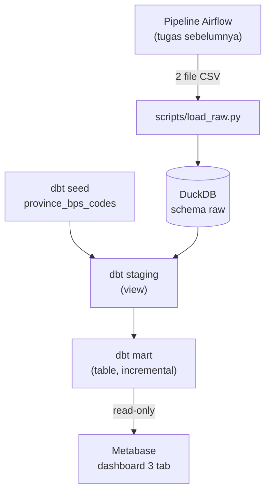
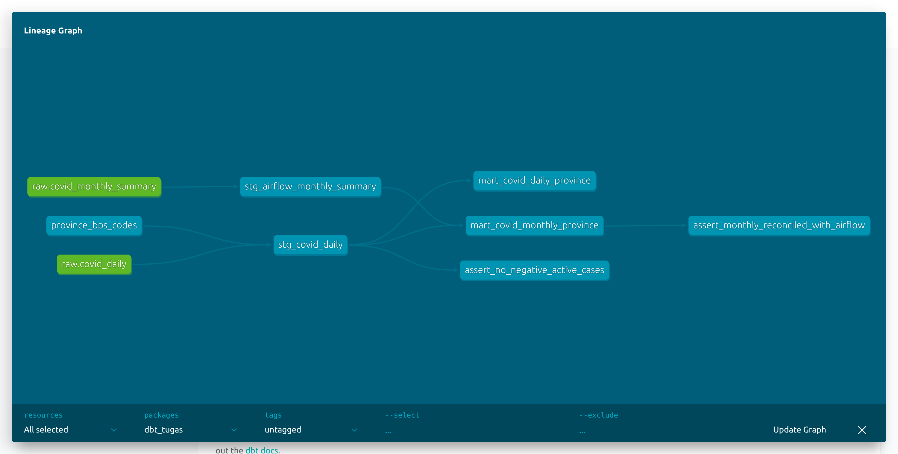
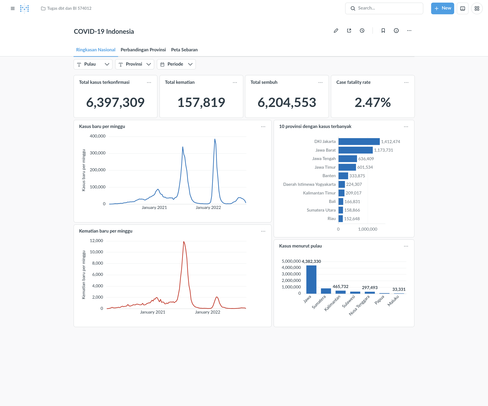
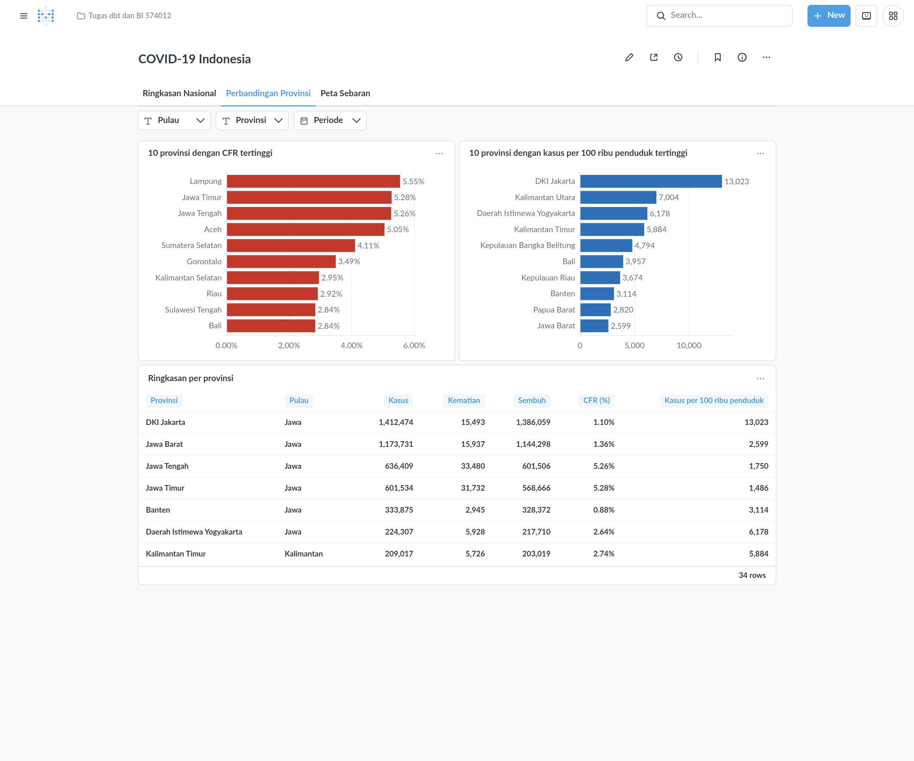
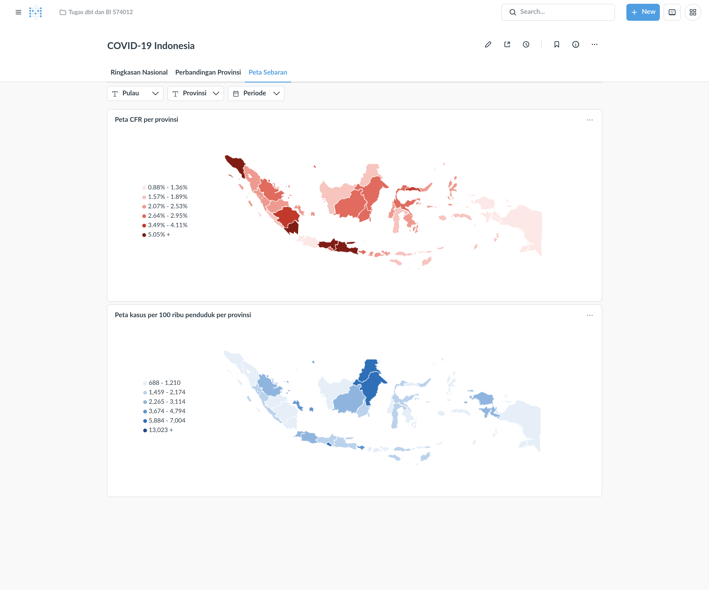

# Transformasi Data dengan dbt dan Dashboard BI dengan Metabase

**Studi kasus: COVID-19 Indonesia** (lanjutan Tugas Airflow - ETL Pipeline Sederhana, Opsi A)

| | |
|---|---|
| **Nama** | Wahyu Primayasa |
| **NIM** | 25/574012/PPA/07232 |
| **Mata Kuliah** | Data Warehouse dan Business Intelligence, DCSE UGM |
| **Stack** | dbt-core 1.12 + dbt-duckdb, DuckDB, Metabase, Docker Compose |

## Daftar Isi

1. [Ringkasan](#1-ringkasan)
2. [Quick Start](#2-quick-start)
3. [Struktur proyek](#3-struktur-proyek)
4. [Sumber data](#4-sumber-data)
5. [Instalasi](#5-instalasi)
6. [Model dbt](#6-model-dbt)
7. [Dashboard](#7-dashboard)
8. [Dokumentasi dan bukti eksekusi](#8-dokumentasi-dan-bukti-eksekusi)
9. [Pemetaan ke deliverables tugas](#9-pemetaan-ke-deliverables-tugas)

---

## 1. Ringkasan

Alur data dari tugas sebelumnya sampai dashboard:



### Petunjuk cepat:

- Checklist deliverables tugas dan letak filenya: [bagian 9](#9-pemetaan-ke-deliverables-tugas).
- Menjalankan proyek dari nol: [Quick Start](#2-quick-start).
- Menyalakan ulang dashboard yang sudah pernah dibuat: [Instalasi - Skenario B](#skenario-b---hanya-menayangkan-dashboard).
- Laporan lengkap, termasuk tests dan data quality: [`docs/laporan.pdf`](docs/laporan.pdf).

---

## 2. Quick Start

**Requirements**: Docker dan Docker Compose, port 3000 dan 8081 kosong.

Jalankan dua perintah ini di dua terminal terpisah, keduanya dari folder proyek.

Terminal 1, menyalakan semua service:

```bash
docker compose up -d --build
```

Terminal 2, memantau log prosesnya:

```bash
docker compose logs -f dbt metabase-setup
```

> [!TIP]
> Perintah di terminal 1 baru kembali setelah dbt selesai dan Metabase siap, jadi log dipantau dari terminal lain. Proses selesai ketika log menampilkan alamat dashboard dan baris `login:`. Hentikan pemantauan log dengan `Ctrl+C`; service tetap berjalan.

Setelah selesai:

| Layanan | Alamat | Login |
|---|---|---|
| Dashboard Metabase | http://localhost:3000 | perlu, lihat akun di bawah |
| dbt docs (lineage graph) | http://localhost:8081 | tidak perlu |

**Akun default Metabase** (dibuat otomatis oleh `metabase-setup`):

| | |
|---|---|
| **Email** | `admin@tugas.local` |
| **Password** | `Tugas574012!` |

> [!NOTE]
> Akun ini hanya dipakai di lokal. Email dan password bisa diganti lewat variabel `MB_ADMIN_EMAIL` dan `MB_ADMIN_PASSWORD` sebelum `docker compose up` pertama.

> [!NOTE]
> Build pertama mengunduh Metabase (sekitar 660 MB), dan Metabase butuh 1-2 menit untuk siap setelah container menyala.

---

## 3. Struktur proyek

```text
574012_Wahyu_Primayasa_dbtBI/
├── dbt_project/
│   ├── models/
│   │   ├── staging/
│   │   │   ├── stg_covid_daily.sql              # view: data harian per provinsi
│   │   │   ├── stg_airflow_monthly_summary.sql  # view: ringkasan bulanan versi Airflow
│   │   │   └── schema.yml                       # sources, deskripsi, generic tests
│   │   └── marts/
│   │       ├── mart_covid_monthly_province.sql  # table: ringkasan bulanan (join 2 staging)
│   │       ├── mart_covid_daily_province.sql    # incremental: fakta harian
│   │       └── schema.yml
│   ├── seeds/
│   │   ├── province_bps_codes.csv               # kode ISO provinsi -> kode BPS (kunci peta)
│   │   └── schema.yml
│   ├── tests/                                   # 2 custom singular test
│   ├── dbt_project.yml
│   └── profiles.yml
├── data/
│   ├── airflow_output/                          # CSV hasil pipeline Airflow
│   └── warehouse.duckdb                         # schema raw + hasil dbt
├── scripts/load_raw.py                          # CSV Airflow -> schema raw DuckDB
├── dashboard/
│   ├── setup_metabase.py                        # membuat dashboard lewat API Metabase
│   ├── export/                                  # export PDF tiap tab dari Metabase
│   ├── metabase_dashboard_export.json           # export definisi dashboard (JSON)
│   └── screenshots/                             # screenshot dashboard kondisi final
├── docker/                                      # Dockerfile dbt dan Metabase
├── docker-compose.yml                           # stack lokal untuk menjalankan tugas
├── docs/
│   ├── laporan.tex / laporan.pdf                # dokumentasi
│   ├── images/                                  # screenshot untuk laporan
│   └── logs/                                    # log dbt run dan dbt test
├── requirements.txt
└── README.md
```

---

## 4. Sumber data

Tugas ini memakai **Opsi A**: output pipeline Airflow dari tugas sebelumnya. Dua file disalin ke `data/airflow_output/`:

| Tabel raw | File | Baris | Task Airflow asal |
|---|---|---|---|
| `raw.covid_daily` | `covid_extracted.csv` | 30.893 | `extract_data >> validate_data` |
| `raw.covid_monthly_summary` | `covid_provinsi_monthly_summary.csv` | 1.052 | `load_data` |

- **Cakupan:** data harian 34 provinsi, 1 Maret 2020 sampai 15 September 2022.
- **Dataset asal:** [COVID-19 Indonesia Dataset](https://www.kaggle.com/datasets/hendratno/covid19-indonesia) (Kaggle, Hendratno).
- **Cara muat:** `scripts/load_raw.py` memuat kedua CSV dengan semua kolom bertipe teks dan nama kolom asli, sehingga pembersihan dikerjakan staging dbt.

---

## 5. Instalasi

Proyek dijalankan dengan Docker Compose.

| Service | Image | Tugas | Sifat |
|---|---|---|---|
| `dbt` | dbt | Memuat CSV ke schema `raw`, lalu `dbt seed`, `dbt run`, `dbt test`, `dbt docs generate` | Sekali jalan |
| `metabase-setup` | dbt | Membuat akun admin, koneksi DuckDB, card, dan dashboard lewat API Metabase | Sekali jalan |
| `metabase` | Metabase | Menyajikan dashboard di port 3000 | Hidup terus |
| `dbt-docs` | dbt | Menyajikan dokumentasi dbt di port 8081 | Hidup terus, opsional |

> [!NOTE]
> dbt dan Metabase adalah container terpisah. Penghubungnya hanya file `data/warehouse.duckdb`: ditulis dbt, dibaca Metabase secara read-only. `metabase-setup` dan `dbt-docs` memakai image dbt yang ada karena butuh Python.

### Skenario A - Dari nol

Titik awalnya hanya dua CSV di `data/airflow_output/`.

1. Hapus hasil sebelumnya (lewati bila ini kali pertama):

   ```bash
   docker compose down -v          # hapus container dan data aplikasi Metabase
   rm -f data/warehouse.duckdb     # hapus warehouse; dibuat ulang dari CSV
   ```

2. Jalankan semuanya:

   ```bash
   docker compose up -d --build                  # terminal 1
   docker compose logs -f dbt metabase-setup     # terminal 2, pantau log
   ```

   Pakai dua terminal seperti di [Quick Start](#2-quick-start).

3. Urutan yang terjadi secara otomatis:
   - `dbt` membuat `data/warehouse.duckdb` dari CSV, membangun staging dan mart, menjalankan 24 test, dan membuat dokumentasi.
   - `metabase` menyala setelah `dbt` selesai tanpa error.
   - `metabase-setup` membuat dashboard, lalu mencetak alamatnya di akhir log.
   - `dbt-docs` menyajikan dokumentasi dbt.

4. Buka http://localhost:3000 (login dengan [akun default](#2-quick-start)) dan http://localhost:8081.

### Skenario B - Hanya menayangkan dashboard

Setelah Skenario A pernah selesai, cukup nyalakan Metabase:

```bash
docker compose up -d --no-deps metabase
```

- `--no-deps` mencegah Compose menjalankan ulang `dbt` lebih dulu.
- Dashboard langsung tersedia tanpa setup ulang.

> [!IMPORTANT]
> Definisi dashboard tersimpan di volume Docker `metabase-data`, yang tidak ikut ke repo. Di mesin baru, jalankan Skenario A sekali terlebih dahulu.

### Menjalankan ulang dbt

```bash
docker compose stop metabase
docker compose run --rm dbt
docker compose start metabase
```

> [!WARNING]
> DuckDB hanya mengizinkan satu proses penulis. Bila dbt dijalankan saat Metabase masih menyala, dbt gagal dengan `Could not set lock on file`. Hentikan Metabase lebih dulu.

### Perintah lain

| Kebutuhan | Perintah |
|---|---|
| Menjalankan satu perintah dbt, misalnya `dbt test` | Hentikan Metabase, lalu `docker compose run --rm --no-deps -w /workspace/dbt_project dbt dbt test` |
| Membangun ulang dashboard tanpa dbt | Arsipkan dashboard lama di Metabase, lalu `docker compose run --rm --no-deps metabase-setup` |
| Menghentikan semuanya | `docker compose down` |
| Menghentikan dan menghapus data Metabase | `docker compose down -v` |

---

## 6. Model dbt



| Model | Jenis | Isi | Alasan materialization |
|---|---|---|---|
| `stg_covid_daily` | view | Nama kolom snake_case, tanggal `M/D/YYYY` menjadi `date`, angka menjadi numerik, persentase teks (`51.28%`) menjadi angka, kasus aktif negatif menjadi `NULL` | Lapisan pembersih ringan yang harus selalu mengikuti isi raw |
| `stg_airflow_monthly_summary` | view | Ringkasan bulanan Airflow dengan nama kolom rapi dan `YearMonth` menjadi `date` | Sama dengan di atas |
| `mart_covid_monthly_province` | table | Kasus, kematian, sembuh, CFR, recovery rate, dan kasus per 100 ribu penduduk per provinsi per bulan; di-join dengan versi Airflow | Dibaca berulang oleh dashboard, jadi agregasi tidak dihitung ulang tiap query |
| `mart_covid_daily_province` | incremental | Fakta harian per provinsi untuk tren | Data harian hanya bertambah di ujung waktu; run berikutnya cukup memproses tanggal baru |
| `province_bps_codes` | seed | Pemetaan kode ISO provinsi ke kode BPS | Data rujukan kecil dan statis; dipakai sebagai kunci wilayah peta |

Catatan:

- `mart_covid_monthly_province` menggabungkan kedua staging model dan menandai tiap baris dengan `is_reconciled_with_airflow`.
- `mart_covid_daily_province` adalah model incremental (bonus), dengan strategi `delete+insert` dan kunci `province_code` + `report_date`.
- `dbt run` dan `dbt test` bisa dijalankan berulang tanpa error.

---

## 7. Dashboard

Dashboard **COVID-19 Indonesia**, dibangun di Metabase dari kedua mart.

### 7.1 Isi

| Tab | Elemen | Jenis |
|---|---|---|
| **Ringkasan Nasional** | Total kasus, kematian, sembuh, CFR | 4 KPI card |
| | Kasus dan kematian baru per minggu | 2 line chart |
| | 10 provinsi dengan kasus terbanyak | Bar horizontal |
| | Kasus menurut pulau | Bar chart |
| **Perbandingan Provinsi** | 10 provinsi dengan CFR tertinggi | Bar horizontal |
| | 10 provinsi dengan kasus per 100 ribu penduduk tertinggi | Bar horizontal |
| | Ringkasan seluruh provinsi | Tabel |
| **Peta Sebaran** | CFR per provinsi | Peta choropleth |
| | Kasus per 100 ribu penduduk per provinsi | Peta choropleth |

Catatan:

- Tiga filter berlaku di semua tab: **Pulau**, **Provinsi**, dan **Periode**.
- Dashboard terdiri dari tiga tab (bonus: lebih dari satu halaman).
- Warna membedakan jenis ukuran: biru untuk kasus (jumlah maupun per penduduk), merah untuk kematian dan CFR.
- Peta di tab 3 menampilkan ukuran yang sama dengan dua bar chart di tab 2, dengan warna yang sama. Bar chart memuat 10 provinsi teratas, sedangkan peta memuat seluruh 34 provinsi. Makin tua warnanya, makin tinggi nilainya.

> [!NOTE]
> Filter Periode dicocokkan ke awal bulan pada kartu berbasis mart bulanan. Pilih rentang bulan penuh agar seluruh kartu konsisten.

### 7.2 Screenshot kondisi final

**Tab Ringkasan Nasional**



**Tab Perbandingan Provinsi**



**Tab Peta Sebaran**



Contoh filter aktif:

- Pulau = Sumatera, Periode = Juni-September 2021: `dashboard/screenshots/dashboard_filter_sumatera.png`
- Peta dengan Periode = Juni-September 2021: `dashboard/screenshots/dashboard_peta_filter_periode.png`

### 7.3 File dashboard

| File | Isi |
|---|---|
| `dashboard/export/tab_1_ringkasan_nasional.pdf` | Export PDF tab Ringkasan Nasional |
| `dashboard/export/tab_2_perbandingan_provinsi.pdf` | Export PDF tab Perbandingan Provinsi |
| `dashboard/export/tab_3_peta_sebaran.pdf` | Export PDF tab Peta Sebaran |
| `dashboard/metabase_dashboard_export.json` | Export definisi dashboard: tab, filter, kartu, dan query tiap kartu |
| `dashboard/setup_metabase.py` | Script yang membangun ulang dashboard dari nol lewat API Metabase |
| `dashboard/screenshots/` | Screenshot kondisi final |

> [!NOTE]
> Metabase edisi open-source tidak punya file dashboard tunggal seperti `.pbix` di Power BI. Export bawaannya adalah PDF per tab (menu **Share > Export tab as PDF**), yang dipakai untuk ketiga file PDF di atas. File JSON diambil dari API Metabase dan memuat definisi lengkap dashboard; bersama `setup_metabase.py`, dashboard bisa dibangun ulang persis sama di mesin lain.

- `metabase-setup` mencetak alamat dashboard di akhir log (`http://localhost:3000/dashboard/<id>`), bersama email dan password login.
- Login dengan `admin@tugas.local` / `Tugas574012!` (akun default, lihat [Quick Start](#2-quick-start)).
- Dashboard juga ada di collection **Tugas dbt dan BI 574012**.

> [!IMPORTANT]
> Peta butuh koneksi internet. Metabase mengambil GeoJSON provinsi dari [ans-4175/peta-indonesia-geojson](https://github.com/ans-4175/peta-indonesia-geojson) saat peta ditampilkan, karena Metabase hanya menerima peta dari URL publik. Wilayah dicocokkan lewat kode provinsi BPS (`bps_province_code`). Tab lain tetap berfungsi tanpa internet.

---

## 8. Dokumentasi dan bukti eksekusi

| Berkas | Isi |
|---|---|
| `docs/laporan.pdf` | Laporan lengkap, 5 halaman (sumber: `docs/laporan.tex`) |
| `docs/images/dbt_docs_lineage.png` | Screenshot lineage graph dari dbt docs |
| `docs/images/dbt_run.png` | Hasil `dbt seed` dan `dbt run` |
| `docs/images/dbt_test.png` | Hasil `dbt test`, 24 test lulus |
| `docs/logs/` | Log teks `dbt run` dan `dbt test` |

Kompilasi ulang laporan:

```bash
cd docs && latexmk -pdf laporan.tex
```

---

## 9. Pemetaan ke deliverables tugas

| Ketentuan tugas | Letak di repo |
|---|---|
| Data raw di DuckDB, schema `raw`, minimal 200 baris, ada kolom tanggal | `data/warehouse.duckdb`, `scripts/load_raw.py` |
| Staging model (view) | `dbt_project/models/staging/` |
| Mart model (table) dengan `ref()` | `dbt_project/models/marts/mart_covid_monthly_province.sql` |
| Staging kedua dan join pada mart | `stg_airflow_monthly_summary.sql`, di-join di mart bulanan |
| Minimal 2 generic test | `schema.yml` di `staging/`, `marts/`, dan `seeds/` |
| Minimal 2 masalah kualitas data | `docs/laporan.pdf` bagian C |
| Custom singular test | `dbt_project/tests/` |
| Deskripsi model dan kolom | `schema.yml` |
| dbt docs dan lineage graph | `docs/images/dbt_docs_lineage.png`, http://localhost:8081 |
| KPI card, minimal 2 jenis chart, elemen interaktif | [Bagian 7](#7-dashboard) |
| Screenshot lengkap dan file export dashboard | `dashboard/screenshots/`, `dashboard/export/`, `dashboard/metabase_dashboard_export.json` |
| Dokumentasi PDF | `docs/laporan.pdf` |
| Bonus: incremental model | `mart_covid_daily_province.sql` |
| Bonus: dashboard lebih dari satu tab | Tiga tab |
